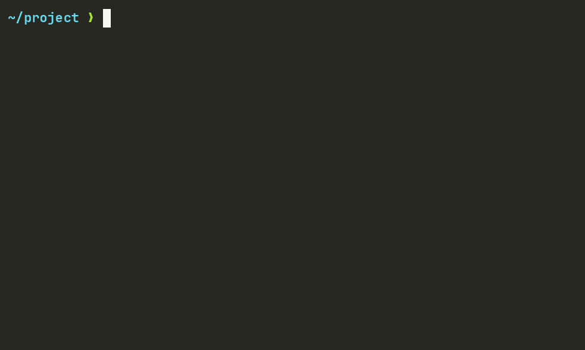

<p align="center">
  
</p>
<p align="center">
  <a href="https://discord.gg/RWuSdBhhFM"></a>
</p>

# Whoopz

**Always-on undo for the Linux terminal.**

Ran `rm`, `mv`, `>`, `sed -i` or `cp` by mistake? Type `whoops` and your files come back.



> **Status: early.** Undo works for bash and zsh, but it is new. Try it in a throwaway folder
> before you trust it with files you care about.

## The idea

Tools like [`try`](https://github.com/binpash/try) and [`maybe`](https://github.com/p-e-w/maybe)
only help if you knew a command was risky *before* you ran it. Safe `rm` replacements like
[`rip`](https://github.com/MilesCranmer/rip2) and [`trash-cli`](https://github.com/andreafrancia/trash-cli)
only cover `rm`.

Whoopz is always on, covers every program, and works *after* the mistake.

## How it works

Your shell runs under a small watcher. Using Linux's
[seccomp user notification](https://man7.org/linux/man-pages/man2/seccomp_unotify.2.html), the
kernel pauses only the system calls that change files (delete, rename, overwrite, truncate) and
asks the watcher first. The watcher saves what is about to be lost, writes a line in a journal,
and lets the call go ahead. Reads are never paused, so the terminal stays fast.

Deleted files are kept with a hard link, so even a 10 GB file is saved instantly, with no copy.

`whoops` reads the journal backwards and puts everything back.

## Install

Whoopz is one static file with no dependencies. It runs on any Linux distribution with
**Linux 5.5 or newer**, on x86_64 or ARM64. Nothing else needs to be installed: not
libseccomp, not a particular C library.

Download `whoops` from the [releases](https://github.com/suraniharsh/whoopz/releases), then:

```sh
tar -xzf whoops-*-linux-x86_64.tar.gz
install -m 755 whoops-*/whoops ~/.local/bin/whoops     # any folder on your PATH
```

Or build it yourself with [Rust](https://rustup.rs):

```sh
git clone https://github.com/suraniharsh/whoopz && cd whoopz
cargo build --release --target x86_64-unknown-linux-musl   # or aarch64-unknown-linux-musl
install -m 755 target/x86_64-unknown-linux-musl/release/whoops ~/.local/bin/whoops
```

## Use

```sh
whoops shell          # start the shell you're in (bash, zsh, fish, nushell, elvish), watched
whoops shell --shell fish
```

Inside that shell, work as usual. When something goes wrong:

```sh
whoops                # undo the last command that changed files
whoops list           # see what each command changed
whoops 3              # undo command 3 from the list
exit                  # leave the watched shell
```

```text
$ rm -rf proj
$ whoops list
   2  rm -rf proj                               4 deleted
$ whoops
Undid 2: rm -rf proj
  restored proj
  restored proj/src
  restored proj/src/main.rs
  restored proj/README
```

To start every terminal this way, the simplest is to set it in your terminal. For kitty, in
`kitty.conf` (with fish; use your shell's path):

```
shell sh -c 'test -x ~/.local/bin/whoops && exec ~/.local/bin/whoops shell --fallback --shell /usr/bin/fish; exec /usr/bin/fish'
```

`--fallback` means that if Whoopz can't start, it says why and starts the shell without it, so
you're never left without a terminal; the `test -x` does the same if `whoops` isn't installed.
kitty only loads its shell integration when it starts the shell itself, so with fish also add
`~/.config/fish/conf.d/whoopz-kitty.fish`:

```fish
if status is-interactive; and set -q WHOOPZ_ACTIVE; and set -q KITTY_INSTALLATION_DIR
    set --global KITTY_SHELL_INTEGRATION enabled
    source "$KITTY_INSTALLATION_DIR/shell-integration/fish/vendor_conf.d/kitty-shell-integration.fish"
    set --prepend fish_complete_path "$KITTY_INSTALLATION_DIR/shell-integration/fish/vendor_completions.d"
end
```

Or at the end of `~/.bashrc` / `~/.zshrc`:

```sh
[ -z "$WHOOPZ_ACTIVE" ] && command -v whoops >/dev/null && whoops shell && exit
```

Or in `~/.config/fish/config.fish`:

```fish
if status is-interactive; and not set -q WHOOPZ_ACTIVE; and command -q whoops
    whoops shell; and exit
end
```

Background jobs (`make &`, a file watcher) get their own `[background]` entry in
`whoops list`, so they never get mixed into the command you're running. Plain `whoops` leaves
them alone; undo one with `whoops <n>`.

Set `WHOOPZ_DEBUG=1` before `whoops shell` to see every call Whoopz pauses.

## What it can't undo

- Anything that leaves your machine: `git push`, email, API calls
- Databases changing their own files
- `sudo` commands: `sudo` gives an error inside a Whoopz shell
- Files over 512 MB on a different drive from `~/.local/share` (a hard link can't cross
  drives, and a copy that big is skipped, with a warning)
- Commands from an earlier `whoops shell` session: undo works within the session it happened in
- A shell started inside the watched shell (`bash`, `zsh`): everything in it counts as one command

Whoopz is a **safety net, not a sandbox**. It is not a security boundary. See
[SECURITY.md](SECURITY.md).

## Where things are kept

Each session has a folder in `~/.local/share/whoopz/sessions/` with its journal and the saved
files. A deleted file is kept with a hard link, so keeping it needs no copy; its disk space
is only freed when the session is cleaned up. Sessions are removed a week after they end.

## Community

Questions, ideas, or Whoopz just saved your day? Come say hi on
[Discord](https://discord.gg/RWuSdBhhFM). Bugs and feature requests go to
[GitHub issues](https://github.com/suraniharsh/whoopz/issues), so they don't get lost in chat.

## Contributing

See [CONTRIBUTING.md](CONTRIBUTING.md), [the vision](docs/vision.md) and [the roadmap](docs/roadmap.md). Whoopz works with
bash, zsh, fish, nushell and elvish today; to add your shell, see [docs/hooks.md](docs/hooks.md).

## License

[MIT](LICENSE)
